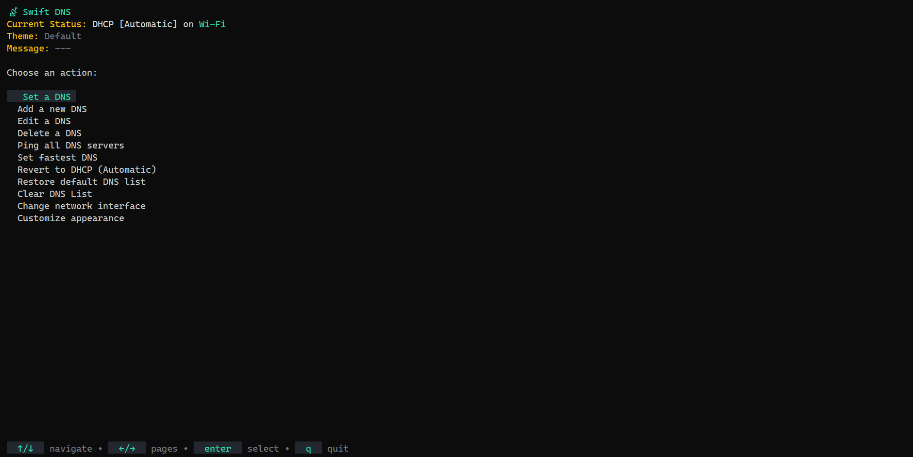
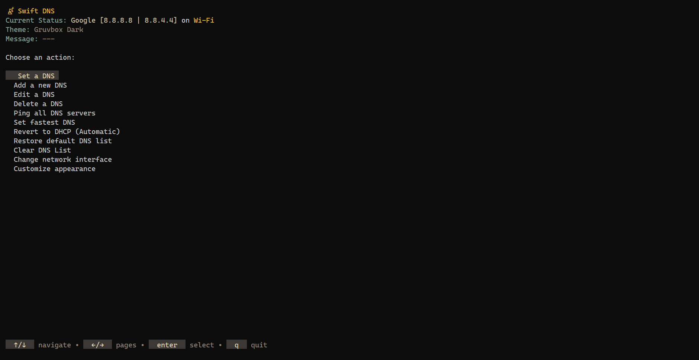
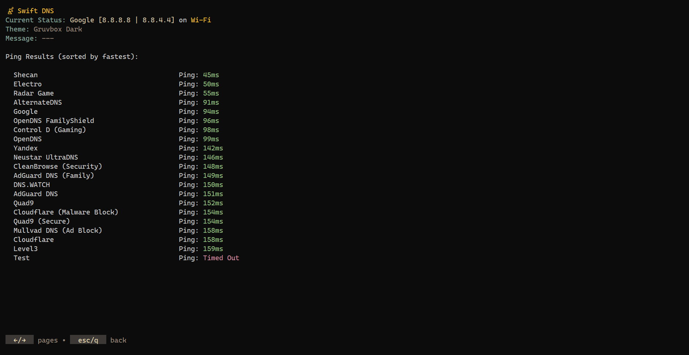
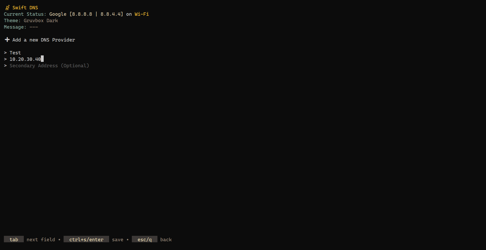
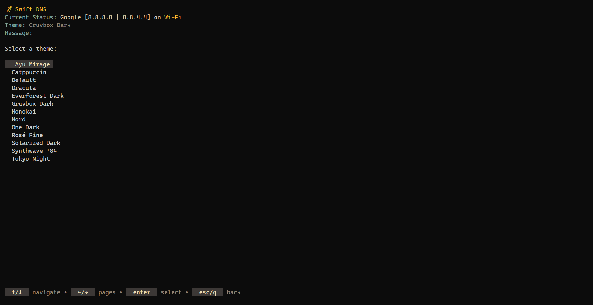

# ⚡ Swift DNS

**The blazingly fast, beautiful, and powerful DNS changer for Windows, right in your terminal.**

Swift DNS is an advanced, terminal-based DNS management tool meticulously engineered for developers, gamers, and power users in the Windows ecosystem. It transforms the tedious task of managing DNS settings into a fast, intuitive, and enjoyable experience. Built with Go and the powerful Bubble Tea TUI framework, it provides a seamless and visually rich interface to control your network's gateway to the internet, all without ever leaving your keyboard.

_(Future support for Linux and macOS is planned!)_

<br/>

<p align="center">
  
</p>

---

## 🤔 Why Swift DNS?

In a world of GUIs and complex network settings panels, why choose a terminal application?

- **Speed:** Every action is instantaneous. Navigate menus, ping servers, and set DNS configurations in milliseconds. The entire application is optimized for keyboard-driven workflows, eliminating the need for slow mouse interactions.
- **Control:** Swift DNS gives you unparalleled control. You can manage a custom list of your favorite providers, find the one with the lowest latency for your current connection, and switch between them effortlessly.
- **Real-time Accuracy:** Unlike other tools that might show stale data, Swift DNS operates on a "single source of truth" principle. It queries your operating system directly, in real-time, ensuring the status you see is always the status that _is_.
- **Aesthetics & User Experience:** A terminal app doesn't have to be ugly. With a rich theming engine and a polished, modern UI, Swift DNS is a pleasure to use.

---

## ✨ Features In-Depth

### Core DNS Management

- **Real-time DNS Status:** The application's header always displays the _actual_ DNS servers configured on your chosen network interface. It intelligently compares the active servers against your list to identify the provider or labels it as `DHCP` or `Custom`.
- **Comprehensive Default List:** Ships with a curated list of 21 trusted DNS providers, covering every need:
  - **Security & Privacy:** Cloudflare (1.1.1.1, 1.1.1.2), Quad9 (9.9.9.9, 9.9.9.10), OpenDNS, Comodo Secure.
  - **Performance:** Google, Level3, Neustar UltraDNS.
  - **Ad-Blocking:** AdGuard DNS, Mullvad DNS.
  - **Gaming Optimized:** Radar Game, Control D (Gaming).
  - **Family Safety:** AdGuard DNS (Family), OpenDNS FamilyShield.
  - **Region-Specific (Iran):** Shecan, Electro.
- **Full Provider Management (CRUD):**
  - **Add:** Create new DNS providers with a name, a primary address, and an optional secondary address.
  - **Edit:** Modify the name and IP addresses of any existing provider.
  - **Delete:** Permanently remove providers from your custom list.
  - **Reset to Default:** Instantly revert your provider list back to the original, clean slate.
  - **Clear All:** Quickly wipe the entire DNS provider list to start fresh, perfect for users who want to build a completely custom list from scratch.
  - All changes are saved to a persistent `dns_config.json` file.

### Advanced Networking Tools

- **Intelligent Interface Detection:** On first launch, Swift DNS scans for all active network adapters and prompts you to select one. Your choice is saved, but you can switch to another interface at any time from the main menu.
- **Blazing-Fast Concurrent Ping:**
  - The "Ping all" feature uses Go's powerful concurrency (goroutines and channels) to ping every DNS provider in your list _simultaneously_, delivering results in a fraction of the time it would take to do it sequentially.
  - Results are beautifully displayed and sorted from lowest to highest latency.
- **"Find & Set Fastest DNS" Magic:** This is the app's killer feature. It performs a concurrent ping test and then **automatically applies the DNS provider with the best response time**, ensuring optimal performance for your current network conditions.

### User Experience & Customization

- **Elegant TUI:** Built with the incredible [Bubble Tea](https://github.com/charmbracelet/bubbletea) framework, providing a smooth, responsive, and stateful application experience that feels native to the terminal.
- **Rich Theming Engine:** Personalize your experience by choosing from **13 gorgeous, hand-picked themes**:
  - Default, Dracula, Solarized Dark, Nord, Gruvbox Dark, Monokai, Tokyo Night, Catppuccin, One Dark, Ayu Mirage, Synthwave '84, Everforest Dark, Rosé Pine.
- **Smart Admin Elevation:** The application automatically detects if it's running without administrator privileges. If needed, it will use a PowerShell command to re-launch itself with an elevated (UAC) prompt, providing a seamless user flow.
- **Clear Feedback:** Timed success and error messages provide clear, non-intrusive feedback for every action you take.

---

## 📸 Screenshots

<p align="center">
  
  <br>
  
  
</p>

---

## 🚀 Getting Started

### Prerequisites

- Go 1.21+
- **Windows OS (Currently)**

### Installation & Usage

1. Clone the repository:

   ```sh
   git clone https://github.com/mahanfakhimi/swift-dns.git
   cd swift-dns
   ```

2. Run the application:
   ```sh
   go run .
   ```
3. (Optional) Build the executable:
   ```sh
   go build -o SwiftDNS.exe .
   ```
   And run with `./SwiftDNS.exe`.

### Development Mode

To get detailed logs for debugging, run the app with the `-dev` flag. This will generate a `debug.log` file in the application's directory.

```sh
go run . -dev
```

---

## ⌨️ Keyboard Navigation

Swift DNS is designed to be entirely keyboard-driven.

| Key(s)      | Action                                   |
| :---------- | :--------------------------------------- |
| **↑ / ↓**   | Navigate up and down through list items. |
| **← / →**   | Navigate between pages in long lists.    |
| **Enter**   | Select or confirm an action.             |
| **Esc / q** | Go back to the previous menu or cancel.  |
| **q**       | (In Main Menu) Quit the application.     |
| **Ctrl+C**  | Force quit the application at any time.  |
| **Tab**     | (In Forms) Move to the next input field. |
| **Ctrl+S**  | (In Forms) Save the form.                |

---

## 🔧 Technical Stack

- **[Bubble Tea](https://github.com/charmbracelet/bubbletea):** The core framework for the Terminal User Interface (TUI).
- **[Lipgloss](https://github.com/charmbracelet/lipgloss):** The styling engine for creating beautiful, themeable terminal layouts.
- **[pro-bing](https://github.com/prometheus-community/pro-bing):** A robust library for performing accurate ICMP pings.
- **Native Windows Commands:** Uses `netsh` and `PowerShell` for reliable, low-level DNS management and network interface queries.

---

## 🤝 Contributing

Contributions are what make the open-source community such an amazing place to learn, inspire, and create. Any contributions you make are **greatly appreciated**.

1.  Fork the Project
2.  Create your Feature Branch (`git checkout -b feature/AmazingFeature`)
3.  Commit your Changes (`git commit -m 'Add some AmazingFeature'`)
4.  Push to the Branch (`git push origin feature/AmazingFeature`)
5.  Open a Pull Request

---

## 📄 License

Distributed under the MIT License. See `LICENSE` for more information.
